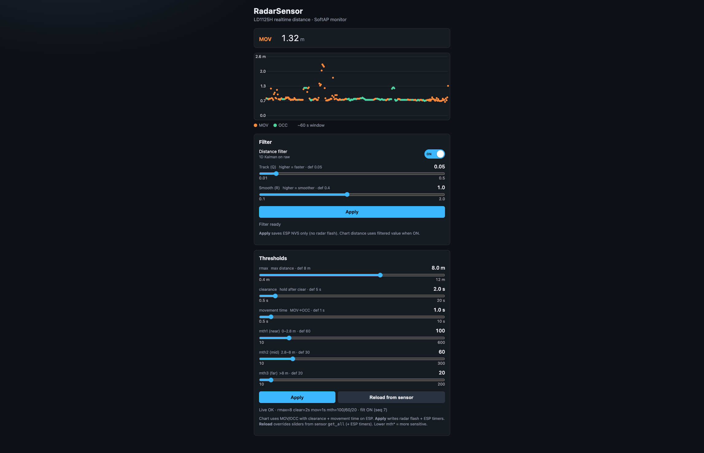

# esp-radarsensor

ESP32 firmware to test **HLK-LD1125H** 24 GHz radar sensitivity vs distance. Prints detections over USB Serial and serves a SoftAP web UI with a realtime distance chart and `rmax` / `mth*` config. Built with PlatformIO (Arduino framework), same stack as `esp-smartClock`.

## Hardware

| Part            | Role                           |
| --------------- | ------------------------------ |
| ESP32 DevKit    | MCU + USB Serial + SoftAP      |
| HLK-LD1125H-24G | 24 GHz presence / motion radar |

### Wiring

| LD1125H | ESP32 DevKit |
| ------- | ------------ |
| VCC     | 5V / VIN     |
| GND     | GND          |
| TX      | GPIO16 (RX2) |
| RX      | GPIO17 (TX2) |

UART: **115200 8N1**. Mount the module ~5 cm away from the ESP Wi‑Fi antenna and switching regulators to reduce false triggers.

## SoftAP monitor (chart + filter + thresholds)



1. Flash firmware and power the board.
2. Join Wi‑Fi AP **`RadarSensor`** (open / no password).
3. Open one of:
   - **http://radarsensor.monitor/** (SoftAP DNS catch-all)
   - **http://192.168.4.1/**
   - **http://radarsensor.local/** (mDNS; works on many phones/desktops)

**UI**

- Live MOV/OCC + distance
- Offline canvas chart (~60 s window)
- **Filter** panel (ESP-only): ON/OFF switch + Track(Q) / Smooth(R)
  - Pipeline: 1D Kalman on raw distance (`radar_filter` module)
  - **Apply filter** — ESP NVS only (does **not** rewrite radar flash)
- **Thresholds** form: `rmax`, clearance, movement time, `mth1`–`mth3`
  - **Apply** — write radar flash (`save`) + ESP timers (NVS)
  - **Reload from sensor** — `get_all`; **overrides** threshold sliders (+ ESP timers/filter from live)

| Control       | Meaning                               | Default / range |
| ------------- | ------------------------------------- | --------------- |
| Filter ON/OFF | Use filtered vs raw distance          | ON              |
| Track (Q)     | Kalman process noise (higher=faster)  | 0.05 (0.01–0.5) |
| Smooth (R)    | Kalman meas. noise (higher=smoother)  | 0.4 (0.1–2)     |
| rmax          | Max detection distance (module)       | 8 m (0.4–12)    |
| clearance     | Hold occupied after last detect (ESP) | 5 s (0.5–20)    |
| movement time | Hold MOV before OCC (ESP)             | 1 s (0.5–10)    |
| mth1–3        | Segment sensitivity (module)          | see table below |

`rmax`/`mth*` come from module `get_all`. Clearance/movement/filter are ESP-side (NVS), not LD1125H UART. Lower `mth*` = more sensitive.

## Serial output

When a target is detected the radar sends ASCII lines; firmware prints:

- `MOV 1.23 m (raw 1.25)` — larger motion (`mov, dis=…`); active then raw meters
- `OCC 0.85 m (raw 0.90)` — small motion / static presence (`occ, dis=…`)

No target → no detection lines. On boot, `get_all` is sent so current thresholds dump to USB Serial and fill the web form.

## Live config (USB Serial → radar)

Type a command and press Enter; it is forwarded to the sensor with `\r\n`:

| Command   | Purpose                                       |
| --------- | --------------------------------------------- |
| `get_all` | Dump current parameters                       |
| `VER`     | Firmware version                              |
| `rmax=8`  | Max detection range (m, def 8)                |
| `mth1=60` | Sensitivity 0–2.8 m (10–600, step 10, def 60) |
| `mth2=30` | Sensitivity 2.8–8 m (10–300, step 10, def 30) |
| `mth3=20` | Sensitivity >8 m (10–200, step 10, def 20)    |
| `save`    | Persist on the module                         |

Exact threshold names can vary by module firmware (`th*_mov` / `th*_occ`); firmware also maps `th1_mov`…`th3_mov` into the UI’s `mth*` fields.

## Working flow

1. Install PlatformIO Core once:
   ```bash
   brew install platformio
   # or: pip install platformio
   ```
2. Connect the ESP32 over USB (`ls /dev/cu.*`).
3. From the repo root:
   ```bash
   ./scripts/build.sh      # compile
   ./scripts/flash.sh      # compile + upload
   ./scripts/monitor.sh    # flash + serial monitor
   ```
   Or directly:
   ```bash
   pio run -e esp32dev
   pio run -e esp32dev -t upload
   pio device monitor -e esp32dev
   ```

GPIO LED (D2) blinks ~1 Hz as a heartbeat.
